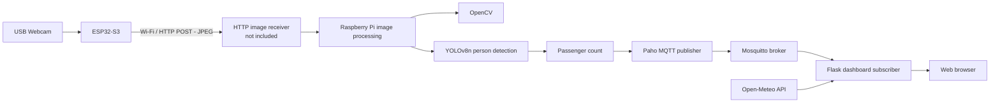
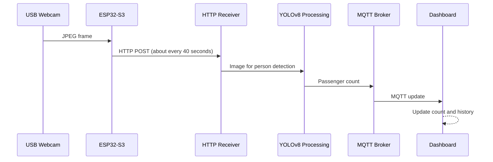
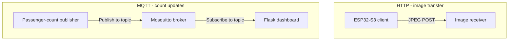

# Smart Bus Halt Passenger Monitoring System

<p align="center">
  
</p>

<h1 align="center">Smart Bus Halt Passenger Monitoring System</h1>

<p align="center">
  An IoT-based passenger-monitoring prototype combining embedded image capture,
  computer vision, wireless communication, and a web dashboard.
</p>

<p align="center">
  <strong>Developed by Team IntelliSense</strong><br>
  University of Moratuwa, Sri Lanka
</p>

---

## Project Overview

The Smart Bus Halt Passenger Monitoring System is a prototype for observing passenger activity at bus halts. An ESP32-S3 with a USB webcam captures JPEG images and sends them over Wi-Fi to a Raspberry Pi. Images can be analyzed with YOLOv8 to detect people, and passenger-count updates are sent to an MQTT broker for display on a web dashboard.

The project brings together Internet of Things (IoT), embedded systems, computer vision, wireless communication, and web technologies.

> **Repository status:** This repository contains the ESP32-S3 camera firmware, a desktop image-processing script, the Flask dashboard, and PCB design files. The standalone HTTP image-receiver service and systemd unit files described in the deployment architecture are not included yet. The firmware's upload URL therefore needs a compatible receiver running on the target Raspberry Pi.

## Problem and Objectives

Bus-halt passenger activity can be difficult to monitor continuously by manual observation. This prototype explores an automated approach to capturing images, counting detected people, and making monitoring data available through a dashboard.

- Capture bus-halt images with an ESP32-S3 and USB webcam.
- Send JPEG images over Wi-Fi using HTTP.
- Detect people in images with YOLOv8 and calculate an image-level count.
- Publish passenger-count readings through MQTT.
- Present available monitoring information in a web dashboard.
- Design a custom PCB and enclosure for the hardware.

## Features

- Periodic JPEG image capture and HTTP upload from the ESP32-S3.
- YOLOv8 person detection and annotated image output.
- CSV output from the desktop batch image-processing utility.
- MQTT-based passenger-count updates.
- Dashboard with passenger count, recent history, annotated image, connection status, and locality weather.
- PCB layout and 3D board model files.

**Counting limitation:** The current detection approach counts person detections in each image. It does not track unique people or infer boarding and alighting events.

## System Architecture

The intended end-to-end deployment flow is shown below. The HTTP receiver is a required deployment component but is not part of this repository yet. The included `image_processing.py` is a desktop batch processor, not that receiver.



### Image-to-Dashboard Workflow



### Communication Paths



### Main Components

| Component | Responsibility |
|---|---|
| USB webcam | Captures bus-halt images |
| ESP32-S3 | Acquires images and uploads them over Wi-Fi |
| Raspberry Pi 4 | Intended image-processing and application host |
| Flask | Hosts the included dashboard; an image receiver would be a separate service |
| OpenCV | Image handling and annotation |
| YOLOv8n | Detects people in images |
| Paho MQTT | Python MQTT client |
| Mosquitto | MQTT message broker |
| Open-Meteo | Provides online locality weather, not sensor readings |

## Hardware

| Component | Purpose |
|---|---|
| ESP32-S3 development board | Image acquisition and wireless communication |
| USB webcam | Captures bus-halt images |
| Raspberry Pi 4 Model B | Intended processing and server platform |
| Custom PCB | Hardware integration |
| Custom enclosure | Physical housing for the prototype |

PCB design source and 3D model:

- [PCB design file](PCB/PCB_iot_2026-11-18.pcbdoc)
- [PCB STEP model](PCB/PCB_iot_2026-11-18.step)

## Software and Communication

| Technology | Use |
|---|---|
| C++ / Arduino framework | ESP32-S3 firmware |
| Python | Image processing and dashboard |
| Flask | Web dashboard and expected HTTP receiver framework |
| YOLOv8n | Person detection |
| OpenCV | Image processing |
| MQTT / Mosquitto / Paho MQTT | Passenger-count messaging |
| HTML, CSS, JavaScript | Dashboard interface |
| Open-Meteo API | Online weather information |

### HTTP Image Upload

The ESP32-S3 sends JPEG data using an HTTP `POST` request. Set the receiver address in the firmware before uploading it:

```cpp
const char* SERVER_URL = "http://<RASPBERRY_PI_IP>:5000/upload";
```

The receiver should accept the JPEG payload at `/upload` and return an HTTP success response. The receiver implementation is not currently included in this repository.

### MQTT Passenger Counts

The dashboard subscribes to:

```text
busstops/university_moratuwa/passengers
```

The expected publisher sends a JSON message similar to:

```json
{
  "bus_halt": "University of Moratuwa",
  "passenger_count": 12,
  "timestamp": "2026-11-21 10:30:00",
  "status": "online"
}
```

This is an illustrative message format. The Raspberry Pi publisher/receiver service that generates it is not included in the repository.

## Included Applications

### ESP32-S3 Firmware

Source: [`Count_in_every40second/Count_in_every40second.ino`](Count_in_every40second/Count_in_every40second.ino)

The firmware connects to Wi-Fi, receives JPEG frames from a USB camera, and uploads an image immediately when one is ready, then approximately every 40 seconds. Configure `WIFI_SSID`, `WIFI_PASSWORD`, and `SERVER_URL` in the sketch for your own environment before flashing. Do not commit real credentials.

### Desktop Image Processing

Source: [`image_processing/image_processing.py`](image_processing/image_processing.py)

The script opens a file picker, runs YOLO inference on selected images, draws person detections, and writes annotated images and a CSV report to `processed_images/`. It requires a graphical desktop session and a compatible Ultralytics YOLO model. This script currently processes selected files; it is not an HTTP image receiver.

### Flask Dashboard

Source: [`dashboard/dashboard.py`](dashboard/dashboard.py)

The dashboard subscribes to the MQTT topic above and serves passenger-monitoring pages. It supports the University of Moratuwa prototype and displays the other configured locations as not yet monitored. Online weather comes from Open-Meteo and is not measured by a physical weather sensor. Passenger history is kept in memory and resets when the dashboard restarts.

## Setup

### Hardware Requirements

- ESP32-S3 development board and compatible USB webcam.
- Raspberry Pi 4 Model B (for the intended deployment).
- Wi-Fi network shared by the ESP32-S3 and Raspberry Pi.
- Computer for programming the ESP32-S3 and accessing the dashboard.

### Raspberry Pi Packages

On Raspberry Pi OS, install the system packages:

```bash
sudo apt update
sudo apt install -y python3-venv python3-pip python3-opencv \
  libgl1 libglib2.0-0 mosquitto mosquitto-clients
```

Create and activate a virtual environment:

```bash
python3 -m venv --system-site-packages ~/passenger_env
source ~/passenger_env/bin/activate
```

Install the Python dependencies used by the included dashboard and image-processing script:

```bash
pip install flask ultralytics paho-mqtt
```

Install versions compatible with your Raspberry Pi OS, Python version, and hardware. OpenCV is installed above through the OS package manager.

Enable and start Mosquitto:

```bash
sudo systemctl enable --now mosquitto
sudo systemctl status mosquitto
```

### Configure the ESP32-S3

1. Connect the USB webcam to the ESP32-S3.
2. Set your Wi-Fi SSID and password in the firmware locally.
3. Set `SERVER_URL` to the address of a compatible image-receiver service.
4. Build and upload the sketch with the Arduino IDE and required ESP32 USB camera libraries.

The upload receiver is not included, so the firmware cannot complete an upload until that service is installed and configured on the Raspberry Pi.

## Running the Included Applications

### Dashboard

Start Mosquitto, activate the Python environment, and run:

```bash
source ~/passenger_env/bin/activate
python dashboard/dashboard.py
```

The dashboard's configured port is `5001`. Open `http://<RASPBERRY_PI_IP>:5001` from a device on the same network. The dashboard can run without a live count, but live readings require an MQTT publisher and broker.

### Desktop Image Processing

On a desktop with a graphical session, install the required dependencies and run:

```bash
python image_processing/image_processing.py
```

Choose one or more images in the file picker. The script writes annotated images and `passenger_count_report.csv` under `processed_images/`.

### Check MQTT Messages

```bash
mosquitto_sub -h localhost \
  -t "busstops/university_moratuwa/passengers" -v
```

## Dashboard Locations

| Bus halt | Status |
|---|---|
| University of Moratuwa | Active prototype location |
| Piliyandala | Coming soon |
| Katubedda | Coming soon |
| Galkissa | Coming soon |
| Bambalapitiya | Coming soon |
| Kollupitiya | Coming soon |
| Colombo | Coming soon |

## Data and Deployment Notes

- The included desktop processor saves its annotated images and CSV report in `processed_images/` relative to the working directory.
- The dashboard serves its latest processed image from the Raspberry Pi's `~/processed_images/` directory.
- Dashboard passenger history is in memory; it is not a permanent database.
- The deployment description may use `~/received_images/`, `~/processed_images/`, `~/passenger_report.csv`, and `~/yolov8n.pt`; create/configure these paths for the receiver service you deploy.
- No image-receiver or project-specific systemd unit files are included yet. Configure and test those services before enabling automatic startup.

## Future Improvements

- Add and document the Raspberry Pi HTTP image receiver and MQTT publisher.
- Add persistent storage for passenger-count history.
- Deploy monitoring units at additional bus halts.
- Add object tracking to estimate unique people and passenger flow.
- Add historical analytics and mobile-friendly notifications.
- Add deployment-specific systemd service files and operational guidance.
- Add photographs of the PCB, enclosure, and dashboard when available.

## Project Team

**Team IntelliSense**<br>
Department of Electronic and Telecommunication Engineering<br>
University of Moratuwa, Sri Lanka

| Team Member |
|---|
| Pasindu Pathirana |
| Prathibha Nirukthi |
| Isuru Umayangana |
| Yasru Dilshan |

## Acknowledgements

We acknowledge the Department of Electronic and Telecommunication Engineering, University of Moratuwa, for the academic environment and support to develop this project. We also acknowledge the open-source communities behind Ultralytics YOLO, OpenCV, Flask, Eclipse Mosquitto, and the Raspberry Pi ecosystem.

---

<p align="center">
  <strong>Smart Bus Halt Passenger Monitoring System</strong><br>
  Developed by Team IntelliSense<br>
  University of Moratuwa, Sri Lanka
</p>
